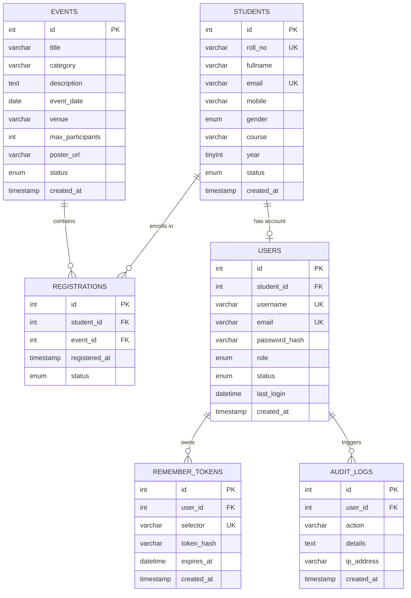

# StudentHub — Entity Relationship (ER) Model & Schema Design

**Subject:** ITUE203 Web Development Frameworks  
**Practical:** 8 — MySQL Schema Design, ER Model, PDO Connectivity, and Prepared Statements  
**Student:** Megh Rana (25CE099)  
**Institution:** CHARUSAT — Faculty of Technology & Engineering  

---

## 1. Conceptual & Logical ER Diagram

---

## 2. Cardinality & Relationship Breakdown

| Relationship | Entities Involved | Cardinality | Explanation |
|---|---|:---:|---|
| **Student to Event** | `STUDENTS` ↔ `EVENTS` | **M : N** | One student can register for multiple events; one event can have many students. Resolved through associative table `REGISTRATIONS`. |
| **Student to Registration** | `STUDENTS` ↔ `REGISTRATIONS` | **1 : M** | One student row links to 0 or many registration rows. Foreign Key `student_id` with `ON DELETE CASCADE`. |
| **Event to Registration** | `EVENTS` ↔ `REGISTRATIONS` | **1 : M** | One event links to 0 or many registration entries. Foreign Key `event_id` with `ON DELETE CASCADE`. |
| **Student to User Account** | `STUDENTS` ↔ `USERS` | **1 : 1 (or 1 : 0..1)** | A student profile may have an authentication record. Admins have no student profile (`student_id = NULL`). |
| **User to Remember Token** | `USERS` ↔ `REMEMBER_TOKENS` | **1 : M** | A user can log in across multiple devices/browsers with separate remember-me tokens. |
| **User to Audit Log** | `USERS` ↔ `AUDIT_LOGS` | **1 : M** | User actions (login, registration, updates) produce permanent audit logs. |

---

## 3. Database Normalization Analysis

### First Normal Form (1NF)
- **Requirement:** All attributes must hold atomic (indivisible) values, and no repeating groups exist.
- **Verification:** 
  - Each column in `students`, `events`, and `registrations` stores atomic values (no delimited lists of event IDs inside student rows).
  - Multi-valued event enrollments are factored into the distinct relational table `registrations`.

### Second Normal Form (2NF)
- **Requirement:** Schema must be in 1NF and free of partial functional dependencies (every non-key attribute must depend fully on the primary key).
- **Verification:**
  - Tables with single-column primary keys (`id`) automatically satisfy 2NF.
  - The associative table `registrations` uses a surrogate primary key `id` alongside a unique compound candidate key `(student_id, event_id)`. Non-key attributes `registered_at` and `status` depend on the whole enrollment event, not just one side.

### Third Normal Form (3NF)
- **Requirement:** Schema must be in 2NF and free of transitive functional dependencies (no non-key attribute depends on another non-key attribute: $X \to Y$ only where $X$ is a superkey).
- **Verification:**
  - In `students`, course information is an identifier string without storing embedded department heads or campus addresses inside student rows.
  - User authentication attributes (`password_hash`, `role`, `last_login`) are normalized into `users` rather than mixed directly into `students`, separating identity from academic records.

---

## 4. Comprehensive Data Dictionary

### Table: `students`
| Column Name | Data Type | Nullable | Key | Default | Description |
|---|---|:---:|:---:|---|---|
| `id` | `INT` | NO | PK | `AUTO_INCREMENT` | Unique surrogate identifier |
| `roll_no` | `VARCHAR(20)` | NO | UK | None | University roll number (e.g. 25CE099) |
| `fullname` | `VARCHAR(100)` | NO | — | None | Student's full legal name |
| `email` | `VARCHAR(100)` | NO | UK | None | Unique university/personal email |
| `mobile` | `VARCHAR(15)` | NO | — | None | 10-digit mobile contact number |
| `gender` | `ENUM('male','female','other')` | NO | — | None | Gender identification |
| `course` | `VARCHAR(50)` | NO | IDX | None | Engineering degree program code |
| `year` | `TINYINT UNSIGNED` | NO | IDX | None | Academic year of study (1 to 4) |
| `status` | `ENUM('active','inactive')` | NO | IDX | `'active'` | Enrollment status (supports soft delete) |
| `created_at` | `TIMESTAMP` | NO | — | `CURRENT_TIMESTAMP` | Account creation timestamp |
| `updated_at` | `TIMESTAMP` | NO | — | `ON UPDATE CURRENT_TIMESTAMP` | Timestamp of last modification |

### Table: `events`
| Column Name | Data Type | Nullable | Key | Default | Description |
|---|---|:---:|:---:|---|---|
| `id` | `INT` | NO | PK | `AUTO_INCREMENT` | Event identifier |
| `title` | `VARCHAR(150)` | NO | — | None | Headline/Title of event |
| `category` | `VARCHAR(50)` | NO | IDX | None | Category (Technical, Workshop, Sports) |
| `description` | `TEXT` | NO | — | None | Comprehensive event overview |
| `event_date` | `DATE` | NO | IDX | None | Scheduled calendar date |
| `venue` | `VARCHAR(100)` | NO | — | None | Physical campus venue |
| `max_participants`| `INT UNSIGNED` | NO | — | `100` | Seat capacity ceiling |
| `poster_url` | `VARCHAR(255)` | YES | — | `NULL` | Optional banner image file path |
| `status` | `ENUM('upcoming','completed','cancelled')` | NO | — | `'upcoming'` | Current lifecycle status |
| `created_at` | `TIMESTAMP` | NO | — | `CURRENT_TIMESTAMP` | Record creation timestamp |

### Table: `registrations`
| Column Name | Data Type | Nullable | Key | Default | Description |
|---|---|:---:|:---:|---|---|
| `id` | `INT` | NO | PK | `AUTO_INCREMENT` | Registration ticket ID |
| `student_id` | `INT` | NO | FK | None | References `students(id)` CASCADE |
| `event_id` | `INT` | NO | FK | None | References `events(id)` CASCADE |
| `registered_at` | `TIMESTAMP` | NO | — | `CURRENT_TIMESTAMP` | Timestamp when student enrolled |
| `status` | `ENUM('registered','attended','cancelled')` | NO | — | `'registered'` | Participation tracking status |

---

## 5. Advanced Extension: Stored Procedures

The database includes MySQL stored procedures for procedural encapsulation:

1. **`sp_register_student_event(p_student_id, p_event_id, OUT p_result)`**
   - Validates duplicate registration.
   - Computes capacity count vs `max_participants`.
   - Inserts registration if capacity allows; returns `'SUCCESS'`, `'ALREADY_REGISTERED'`, or `'EVENT_FULL'`.

2. **`sp_get_student_summary(p_student_id)`**
   - Aggregates student enrollment profile and computes total registered events using `LEFT JOIN` and `GROUP BY`.
